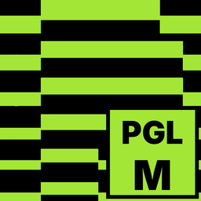
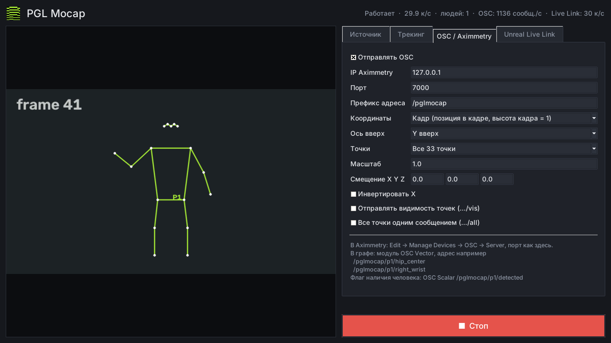

# PGL Mocap

**Захват движения человека по обычной камере — без костюмов, маркеров и датчиков.**
Программа находит человека в видео, отслеживает 33 точки тела и в реальном времени
передаёт координаты в **Aximmetry** (по OSC) и в **Unreal Engine** (через Live Link).



## Возможности

- **Любой видеовход:** веб-камера, карта захвата (Elgato, Magewell, AVerMedia, Blackmagic и др.),
  **NDI**-источник по сети, видеофайл.
- **33 точки тела**, до **4 человек** одновременно, у каждого свой стабильный номер.
- **Пальцы рук** (21 точка на руку) и **мимика лица** (51 коэффициент ARKit: моргание, взгляд, рот, улыбка, брови + поворот головы) — включаются отдельными галочками.
- **Aximmetry:** координаты каждой точки по OSC — сразу в модули *OSC Vector* / *OSC Scalar*.
- **Unreal Engine 5.6+:** каждая точка — объект Live Link, плюс скелет из 17 костей.
- Можно отправлять в Aximmetry и Unreal одновременно.
- Сглаживание дрожания, удержание позы при кратковременной потере, зеркало, поворот кадра,
  подстройка масштаба и осей под вашу сцену.
- Работает на обычном процессоре, видеокарта не обязательна. Настройки запоминаются.
- **Приложение для Android:** телефон сам распознаёт позу и отправляет данные — без компьютера с PGL Mocap.

## Скачать

| Что | Файл | Для чего |
|---|---|---|
| **Windows** 10 / 11 — установщик (рекомендуется) | [PGL_Mocap_Setup.exe](https://github.com/4007079-ship-it/PGL-Mocap/releases/latest/download/PGL_Mocap_Setup.exe) | программа с ярлыками и настройкой брандмауэра |
| **Windows** 10 / 11 — без установки (portable) | [PGL_Mocap_win64.zip](https://github.com/4007079-ship-it/PGL-Mocap/releases/latest/download/PGL_Mocap_win64.zip) | распаковал и запустил, права администратора не нужны |
| **Linux** x64 — Ubuntu 22.04+, Debian 12+, Mint 21+ | [PGL_Mocap_linux_x64.tar.gz](https://github.com/4007079-ship-it/PGL-Mocap/releases/latest/download/PGL_Mocap_linux_x64.tar.gz) | программа |
| **macOS** 13+ — Apple Silicon (M1 и новее) | [PGL_Mocap_macOS.dmg](https://github.com/4007079-ship-it/PGL-Mocap/releases/latest/download/PGL_Mocap_macOS.dmg) | программа |
| **macOS** 13+ — Intel | [PGL_Mocap_macOS_Intel.dmg](https://github.com/4007079-ship-it/PGL-Mocap/releases/latest/download/PGL_Mocap_macOS_Intel.dmg) | программа |
| **Android** 8+ (64-битный телефон) | [PGL_Mocap_android.apk](https://github.com/4007079-ship-it/PGL-Mocap/releases/latest/download/PGL_Mocap_android.apk) | телефон сам распознаёт позу и отправляет в Aximmetry / Unreal |
| **Плагин для Unreal Engine** 5.6+ | [PGLMocapLiveLink_UE5_plugin.zip](https://github.com/4007079-ship-it/PGL-Mocap/releases/latest/download/PGLMocapLiveLink_UE5_plugin.zip) | приём данных в Unreal |

Ссылки всегда ведут на последнюю версию. Все версии — в разделе [Releases](https://github.com/4007079-ship-it/PGL-Mocap/releases).

## Установка

**Windows — установщик**
1. Запустите `PGL_Mocap_Setup.exe`. Если Windows покажет «Система Windows защитила ваш компьютер» —
   нажмите **Подробнее → Выполнить в любом случае** (программа не подписана платным сертификатом).
2. Оставьте отмеченным пункт **«Разрешить в брандмауэре Windows»** — без него могут не работать NDI и приём данных.
3. Готово: PGL Mocap появится в меню «Пуск» и на рабочем столе. Новая версия ставится поверх старой,
   настройки сохраняются. Удаление — через «Параметры → Приложения».

**Windows — без установки**
1. Распакуйте `PGL_Mocap_win64.zip` в любую папку (например, `C:\PGL Mocap`).
2. Запустите **`PGL Mocap.exe`**.
3. Если Windows спросит про доступ к сети — разрешите (нужно для отправки данных и NDI).

**Linux**
```
tar xzf PGL_Mocap_linux_x64.tar.gz
cd "PGL Mocap"
./"PGL Mocap"
```
Чтобы программа появилась в меню приложений — запустите в той же папке `./install_linux.sh`.

**macOS**
1. Откройте `PGL_Mocap_macOS.dmg` и перетащите **PGL Mocap** в папку **Программы**.
2. Первый запуск: macOS напишет, что не может проверить разработчика (приложение не заверено Apple).
   Нажмите **Готово**, откройте **Системные настройки → Конфиденциальность и безопасность**,
   внизу у сообщения о PGL Mocap нажмите **Всё равно открыть** и подтвердите. Это нужно один раз.
3. Разрешите доступ к **камере** и **локальной сети**, когда macOS спросит, — без них не будет видео,
   NDI и отправки данных.

Какой файл качать: **меню Apple → Об этом Mac**. «Чип Apple M…» — `PGL_Mocap_macOS.dmg`, «Процессор Intel…» — `PGL_Mocap_macOS_Intel.dmg`.
На Intel программа работает медленнее (старые процессоры); если скорость низкая — модель *lite* и ширина анализа 480.

**Android**
1. Скачайте `PGL_Mocap_android.apk` на телефон и откройте файл.
2. Если телефон спросит — разрешите установку из этого источника (приложение не из Google Play).
3. Запустите **PGL Mocap**, разрешите доступ к камере.
4. **Настройки** → IP компьютера с Aximmetry или Unreal → **Применить**. Телефон и компьютер — в одной сети Wi-Fi.

Адреса OSC и субъекты Live Link у телефона такие же, как у программы на компьютере, —
в Aximmetry и Unreal ничего менять не нужно. Кнопка **Камера** переключает основную и фронтальную камеру.

## Как пользоваться

1. **Источник** — выберите тип:
   - *Камера / карта захвата* — устройство из списка (↻ обновляет список), разрешение и FPS.
     Если карта захвата не даёт кадр — выключите *MJPG* и выставьте разрешение, которое реально приходит на вход.
   - *NDI* — нажмите ↻ и выберите источник в сети.
   - *Видеофайл* — для проверки без камеры.
2. **Трекинг** — модель (*lite* — быстрая, *full* — баланс, *heavy* — точная), сколько людей искать, сглаживание.
   Здесь же включаются **Пальцы рук** и **Мимика лица**. Каждая функция добавляет нагрузку — включайте только нужное.
   Для пальцев лучше камера 1080p и человек ближе к камере (руки должны занимать заметную часть кадра).
3. **OSC / Aximmetry** и/или **Unreal Live Link** — куда отправлять (IP и порт).
4. **Старт.** В окне виден скелет, сверху — кадры в секунду, число людей и скорость отправки.

Изменения источника и модели применяются после **Стоп → Старт**, остальные настройки — сразу.

**Совет по съёмке:** человек должен помещаться в кадр целиком, хорошее ровное освещение,
камера на уровне груди.

**Телефон:** на Android ставьте наше приложение **PGL Mocap** (`PGL_Mocap_android.apk`) — телефон сам
распознаёт движение и отправляет данные в Aximmetry / Unreal. Для iPhone своего приложения нет: его можно
использовать как камеру через приложение NDI HX Camera (источник *NDI* в программе на компьютере).

---

## Aximmetry

1. **Edit → Manage Devices → OSC → Server**: адаптер *-any-*, порт как в PGL Mocap (по умолчанию `7000`).
2. В графе добавьте модуль **OSC Vector** с адресом, например, `/pglmocap/p1/hip_center` —
   на выходе вектор X, Y, Z. Подключайте к позиции объекта, камере, параметрам эффектов.
3. Человек в кадре или нет — модуль **OSC Scalar** с адресом `/pglmocap/p1/detected` (1 или 0).

### Адреса OSC

`pN` — номер человека (`p1`…`p4`).

| Адрес | Значение |
|---|---|
| `/pglmocap/count` | сколько людей в кадре |
| `/pglmocap/pN/detected` | 1 — человек найден, 0 — нет |
| `/pglmocap/pN/<точка>` | X Y Z точки |
| `/pglmocap/pN/<точка>/vis` | видимость точки 0..1 (если включено) |
| `/pglmocap/pN/hip_center` | середина между бёдрами — «позиция человека» |
| `/pglmocap/pN/shoulder_center` | середина между плечами |
| `/pglmocap/pN/screen_pos` | центр бёдер в координатах кадра (приходит всегда) |
| `/pglmocap/pN/all` | все точки подряд одним сообщением (если включено) |

**Точки** (left / right — левая / правая сторона *самого человека*):
`nose, left_eye_inner, left_eye, left_eye_outer, right_eye_inner, right_eye, right_eye_outer,
left_ear, right_ear, mouth_left, mouth_right, left_shoulder, right_shoulder, left_elbow, right_elbow,
left_wrist, right_wrist, left_pinky, right_pinky, left_index, right_index, left_thumb, right_thumb,
left_hip, right_hip, left_knee, right_knee, left_ankle, right_ankle, left_heel, right_heel,
left_foot_index, right_foot_index`

В режиме *Основные 13 точек*: nose, плечи, локти, запястья, бёдра, колени, лодыжки.

### Пальцы и мимика

Приходят, только если включены на вкладке «Трекинг». `l` / `r` — левая / правая рука *самого человека*.

| Адрес | Значение |
|---|---|
| `/pglmocap/pN/hand_l/detected` | 1 — рука найдена, 0 — нет |
| `/pglmocap/pN/hand_l/<точка>` | X Y Z точки руки, в тех же координатах, что и тело |
| `/pglmocap/pN/face/detected` | 1 — лицо найдено, 0 — нет |
| `/pglmocap/pN/face/<коэффициент>` | 0..1, например `eyeBlinkLeft`, `jawOpen`, `mouthSmileLeft` |
| `/pglmocap/pN/face/head` | поворот головы: рыскание, тангаж, крен (градусы) |

**Точки руки:** `wrist, thumb_cmc, thumb_mcp, thumb_ip, thumb_tip, index_mcp, index_pip, index_dip, index_tip,
middle_mcp, middle_pip, middle_dip, middle_tip, ring_mcp, ring_pip, ring_dip, ring_tip,
pinky_mcp, pinky_pip, pinky_dip, pinky_tip` (`_tip` — кончики пальцев).

**Коэффициенты мимики** (стандарт ARKit): `eyeBlinkLeft/Right`, `eyeLookUp/Down/In/OutLeft/Right`, `eyeSquintLeft/Right`,
`eyeWideLeft/Right`, `jawOpen`, `jawLeft/Right/Forward`, `mouthClose`, `mouthSmileLeft/Right`, `mouthFrownLeft/Right`,
`mouthPucker`, `mouthFunnel`, `mouthLeft/Right`, `mouthPressLeft/Right`, `mouthStretchLeft/Right`,
`mouthRollLower/Upper`, `mouthShrugLower/Upper`, `mouthUpperUpLeft/Right`, `mouthLowerDownLeft/Right`,
`mouthDimpleLeft/Right`, `browDownLeft/Right`, `browInnerUp`, `browOuterUpLeft/Right`, `cheekPuff`,
`cheekSquintLeft/Right`, `noseSneerLeft/Right`.

### Координаты

- **Кадр** (по умолчанию) — где человек находится в изображении: центр кадра = 0, высота кадра = 1,
  X вправо, Y вверх, Z — примерная глубина. Чтобы объект в сцене следовал за ведущим.
- **Мир** — скелет в метрах относительно центра бёдер (человек всегда «в нуле»). Для жестов и анимации.
  Позиция в кадре при этом всё равно приходит в `…/screen_pos`.
- **Ось вверх** — *Y вверх* или *Z вверх*. **Масштаб**, **Смещение XYZ**, **Инвертировать X** — подгонка под сцену.

---

## Unreal Engine (Live Link)

### Установка плагина

Плагин один раз собирается под вашу версию Unreal. Нужен **Visual Studio 2022** с компонентом
*Game development with C++* — тот же, что для любого C++ в Unreal.

1. Распакуйте `PGLMocapLiveLink_UE5_plugin.zip`.
2. Запустите **`build_plugin.bat`**. Если Unreal стоит не в `C:\Program Files\Epic Games\UE_5.x`,
   укажите путь: `build_plugin.bat "D:\Epic Games\UE_5.6"`. Сборка занимает несколько минут.
3. Скопируйте получившуюся папку `Build\PGLMocapLiveLink` в папку **`Plugins`** вашего проекта
   (рядом с файлом `.uproject`; создайте `Plugins`, если её нет).
4. Откройте проект → **Edit → Plugins** → включены **PGL Mocap Live Link** и **Live Link**.

### Подключение

1. В PGL Mocap: вкладка **Unreal Live Link** → *Отправлять в Unreal Live Link*,
   IP компьютера с Unreal (тот же компьютер — `127.0.0.1`), порт `54321`.
2. В Unreal: **Window → Virtual Production → Live Link** → **+ Source → PGL Mocap** → порт `54321` → **Add**.
3. **Старт** в PGL Mocap — в окне Live Link появятся субъекты, у источника статус *Receiving*.

### Что приходит в Unreal

| Субъект | Роль | Что это |
|---|---|---|
| `PGL_P1_hip_center` | Transform | центр человека (между бёдрами) |
| `PGL_P1_shoulder_center` | Transform | центр между плечами |
| `PGL_P1_<точка>` | Transform | любая из 33 точек: `PGL_P1_right_wrist`, `PGL_P1_nose`, … |
| `PGL_P1` | Animation | скелет из 17 костей с поворотами |
| `PGL_P1_hand_r_index_tip` | Transform | точки пальцев (если включены): `PGL_P1_hand_l_<точка>`, `PGL_P1_hand_r_<точка>` |
| `PGL_P1_face` | Basic | мимика (если включена): кривые `EyeBlinkLeft`, `JawOpen`, … — имена как у Live Link Face, плюс `HeadYawDeg`, `HeadPitchDeg`, `HeadRollDeg` |

`P1`…`P4` — номер человека, префикс `PGL` меняется в настройках. Когда человек уходит из кадра,
его субъекты исчезают и появляются снова, когда он вернётся.

**Координаты** — сразу в системе Unreal: сантиметры, **X вперёд** (куда смотрит человек — к камере),
**Y вправо** (его правая рука), **Z вверх**, пол — `Z = 0`. Перемещение человека по кадру двигает его
по оси Y (настройка *Перемещение, см*; 0 — всегда в начале координат).
Глубину (приближение к камере и удаление от неё) одна камера не измеряет.

### Привязать объект к точке

1. Выберите актор (объект, камеру, свет, эффект Niagara) → **Add Component → Live Link Controller**.
2. **Subject Representation** → субъект, например `PGL_P1_right_wrist`, роль *Transform*.
3. Актор начнёт двигаться за рукой. Чтобы сместить начало координат — вложите актор
   в пустой актор-родитель и двигайте родителя.

### Скелет `PGL_P1`

Кости (родитель в скобках): `root`, `pelvis (root)`, `spine_01 (pelvis)`, `neck_01 (spine_01)`, `head (neck_01)`,
`upperarm_l/r (spine_01)`, `lowerarm_l/r`, `hand_l/r`, `thigh_l/r (pelvis)`, `calf_l/r`, `foot_l/r`.
Трансформы локальные (относительно родителя), ось X каждой кости направлена вдоль кости, ось Z — ось сгиба.
`root` несёт перемещение по площадке, `pelvis` — высоту бёдер над полом.

Скелет доступен в Blueprint и Control Rig. Анимация готового персонажа (Manny, MetaHuman) через ретаргет —
в следующих версиях.

---

## Если что-то не работает

- **Aximmetry ничего не получает** — проверьте IP и порт, что OSC Server включён в *Manage Devices*,
  и что брандмауэр Windows пропускает UDP. Посмотреть, что реально уходит из программы, можно бесплатным
  OSC-монитором **Protokol** (закройте Aximmetry — один порт слушает только одна программа).
- **Камера или карта захвата не открывается** — закройте OBS, Zoom, браузер и другие программы, которые
  могут её занимать; на вкладке «Источник» попробуйте другой бэкенд.
- **NDI не видит источники** — компьютеры в одной сети (гостевой Wi-Fi часто изолирует устройства),
  брандмауэр пропускает программу. Запасной путь — *NDI Webcam Input* из NDI Tools: NDI станет обычной камерой.
- **Низкая скорость** — модель *lite*, ширина анализа 480 или 320, один человек.
- **Unreal: *Port … is busy*** — порт занят другой программой, смените его в обоих местах.
- **Unreal: *Waiting* / *No data*** — в PGL Mocap включена отправка в Live Link и нажат Старт, IP и порт совпадают.
- **Android: «Распознавание не поддерживается на этом устройстве»** — нужен телефон с 64-битным ARM-процессором (большинство телефонов с 2017 года).
- **Android: нет данных на компьютере** — проверьте IP в настройках, что телефон в той же сети Wi-Fi (не гостевой), и что брандмауэр компьютера пропускает UDP.
- **macOS: нет картинки с камеры или данные не уходят** — **Системные настройки → Конфиденциальность и безопасность → Камера / Локальная сеть** → включите PGL Mocap.
- **Linux: нет камеры в списке** — `sudo usermod -aG video $USER` и перезайдите в систему.
- **Проверка программы** — запустите `PGL Mocap.exe --selftest`: появится файл
  `pgl_mocap_selftest.txt` с результатами (рядом с программой, а если она установлена в Program Files —
  в `%APPDATA%\PGL Mocap`). Журнал ошибок: `%APPDATA%\PGL Mocap\pgl_mocap.log`
  (Linux: `~/.config/PGL Mocap/pgl_mocap.log`, macOS: `~/Library/Application Support/PGL Mocap/pgl_mocap.log`). Пришлите эти файлы, если нужна помощь.

---

<sub>В программе используются открытые компоненты: Google MediaPipe и OpenCV (Apache 2.0), NDI® (NDI — товарный знак Vizrt NDI AB).</sub>
